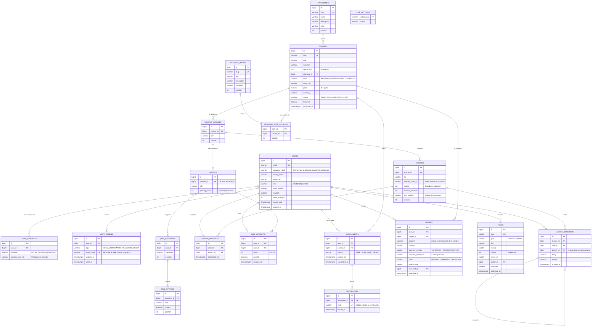

# DER — Monkey Coffe Dev's

Motor: PostgreSQL 16. El esquema lo crean las migraciones Flyway de
`backend/cmd/src/main/resources/db/migration`, que implementan este diagrama.

## Decisiones de diseño

| Decisión | Motivo |
|---|---|
| `USERS` separada de `USER_IDENTITIES` | Una persona es una sola cuenta aunque entre con correo, Google, GitHub o Discord. Añadir otro proveedor no cambia el esquema. |
| `password_hash` nulo | Quien solo usa un proveedor externo no tiene contraseña; puede crearla después con "olvidé mi contraseña". |
| `AUTH_TOKENS` guarda solo el hash | Si se filtra la base, los enlaces de verificación y recuperación no sirven. |
| Curso → Módulo → Clase | Es la estructura de temario que usan las academias de referencia y la que el reproductor recorre en orden (`position`). |
| Una clase admite video, texto o ambos | Evita tablas por tipo de clase; un video con apuntes es el caso más común. |
| El video es un `youtube_video_id` | Los videos viven en YouTube como "no listados". La academia solo entrega el identificador a quien tiene acceso. |
| `price = 0` significa gratis | Un solo campo decide si el curso se abre con inscripción directa o con compra. |
| `ENROLLMENTS` es la única fuente de acceso | Da igual cómo se obtuvo (`FREE`, `PURCHASE`, `GRANT`): tener la fila es tener el curso. |
| `ORDERS` con aprobación manual | El cobro empieza por Yape/Plin. Al aprobar una orden se crea la inscripción en la misma transacción. Una pasarela futura solo cambia quién aprueba. |
| Índice único parcial en órdenes `PENDING` | Impide dos compras abiertas del mismo curso por el mismo estudiante. |
| `LESSON_PROGRESS` por usuario y clase | El porcentaje se calcula, no se guarda: no puede desincronizarse si se añaden clases. |
| `CERTIFICATES.code` público | Cualquiera puede verificar un certificado sin iniciar sesión y sin exponer ids internos. |
| `SITE_SETTINGS` clave-valor | Redes sociales, Discord e instrucciones de pago se cambian desde el panel sin desplegar. |
| Contenido en Markdown | Se escribe cómodo y el servidor lo convierte a HTML saneado; nunca se guarda HTML del usuario. |

## Reglas de negocio

- Un curso se **completa** cuando todas sus clases están marcadas como vistas y todos los cuestionarios
  de sus módulos están aprobados. En ese momento se emite el certificado.
- Las clases con `free_preview` se pueden ver sin inscripción; el resto exige inscripción.
- Solo se listan públicamente los cursos `PUBLISHED`, las rutas y publicaciones con `published = true`.
- Los comentarios solo los pueden escribir estudiantes inscritos; un administrador puede ocultarlos.
